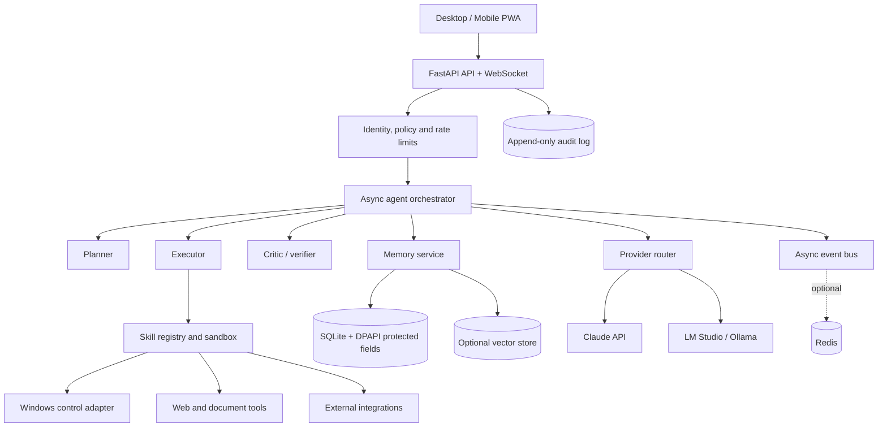

# JARVIS System Architecture

## Goals
Local-first, voice-and-text operating assistant. Existing Windows PC control and mobile PWA remain operational during migration. All integrations are real, permissioned and auditable.

## Context and deployment
- Windows desktop host: FastAPI orchestrator, SQLite memory, local skill runtime, audio services and existing Windows-control adapter.
- Browser clients: current dashboard during migration; Next.js HUD and installable PWA as the replacement frontend.
- Local AI: LM Studio OpenAI-compatible endpoint (current working Gemma models); Ollama adapter supported.
- Cloud AI: Claude adapter is preferred only when an API key is configured and cloud use is enabled for that feature.
- Optional services: Redis for distributed events/queues; Chroma for semantic retrieval; Docker Compose for reproducible deployment.
- Creative tooling: expose the separately installed raea engine through a dedicated, permissioned skill only after its desktop setup and supported command/API surface are verified; never couple it directly to the agent core.

## Component diagram

## Agent lifecycle
1. Normalize request and classify risk.
2. Retrieve relevant short-term context and user-approved memories.
3. Planner produces a bounded task graph with explicit tool names and arguments.
4. Policy engine checks each proposed tool against its manifest, scope and permission tier.
5. Read-only tools may execute within configured limits. Confirm-before-act tools pause for an explicit user approval token. Autonomous tools are restricted to low-risk allowlisted operations.
6. Executor runs one step at a time, records events and applies bounded retries with exponential backoff.
7. Critic checks tool results against the requested outcome; it may request one bounded correction, then stop.
8. Persist outcome and audit metadata. Never represent an unverified action as completed.

## Data model (initial)
- Conversation(id, title, created_at, updated_at)
- Message(id, conversation_id, role, content_ref, created_at, metadata_json)
- Memory(id, kind, content_ciphertext, nonce, created_at, updated_at, source, tags_json, deleted_at)
- Episode(id, conversation_id, summary_ciphertext, created_at, metadata_json)
- Task(id, status, plan_json, created_at, updated_at, approval_state)
- Skill(id, version, manifest_json, enabled, installed_at)
- AuditEvent(id, actor, action, resource, decision, reason, timestamp, correlation_id, metadata_json)
- ScheduledJob(id, name, schedule, payload_ciphertext, enabled, last_run_at, next_run_at)
Sensitive memory payloads are encrypted before persistence; keys are held by the OS vault/DPAPI, never in source control.

## API outline
- GET /api/v1/health
- POST /api/v1/chat (streaming response supported)
- POST /api/v1/agent/tasks and GET /api/v1/agent/tasks/{task_id}
- POST /api/v1/agent/tasks/{task_id}/approve
- GET/POST/DELETE /api/v1/memory
- GET /api/v1/skills; POST /api/v1/skills/{id}/enable
- GET /api/v1/audit
- WS /api/v1/events
- GET /api/v1/system/status
Existing /api/* routes remain supported until frontend and mobile migration is complete.

## Skill manifest
Each skill declares id, version, description, entrypoint, input_schema, permissions, scopes, timeout_seconds, network_hosts, and risk. Runtime rejects unknown permissions, paths outside allowed roots, undeclared network hosts and oversized inputs. Skill content and tool outputs are untrusted data, not policy instructions.

## Event bus
Events are immutable envelopes: id, type, timestamp, correlation_id, actor, payload, sensitivity. Local asyncio queues are the default. Redis Streams adapter is optional for multi-process deployments. Consumers acknowledge events; retries are bounded and dead letters are retained in the audit log.

## Security model
- Permission tiers: read_only, confirm_before_act, autonomous.
- Destructive actions, financial actions and outbound messages always require fresh human approval.
- Per-skill allowlists, rate limits, execution timeouts and kill switch.
- Code execution uses a restricted subprocess sandbox with explicit working directory, resource limits and no inherited secrets.
- Web, file, email and document contents are untrusted evidence. They cannot modify system policy or invoke tools.
- Secrets come from OS credential storage or environment injection; redact from logs.
- Local/cloud provider routing is controlled per feature.
- Bind local services to loopback by default; remote access requires authenticated private networking.

## Failure and fallback paths
- Claude unavailable or cloud disabled: route to local LM Studio/Ollama if enabled.
- Local model unavailable: return a clear degraded-mode error; do not silently send private context to cloud.
- Redis unavailable: local event bus remains active.
- Vector index unavailable: fall back to SQLite keyword/recent-memory retrieval.
- Skill timeout or malformed output: stop that step, audit it and ask the planner for at most one safe correction.
- Approval missing/expired: do not execute.
- Kill switch: reject new tasks, cancel cancellable tasks and disable autonomous skills.

## Stack migration rationale
The current app is a working Python standard-library HTTP server and browser dashboard, with LM Studio and SQLite. Replacing it in one operation risks losing PC-control and mobile access. The new FastAPI backend is being built beside the existing service; routes and adapters will migrate incrementally. Python 3.12 is the target baseline. Current machine has Python 3.13 and 3.15, so the new backend will be kept compatible with 3.12+ and validated on an available supported runtime before pinning the deployment image.
